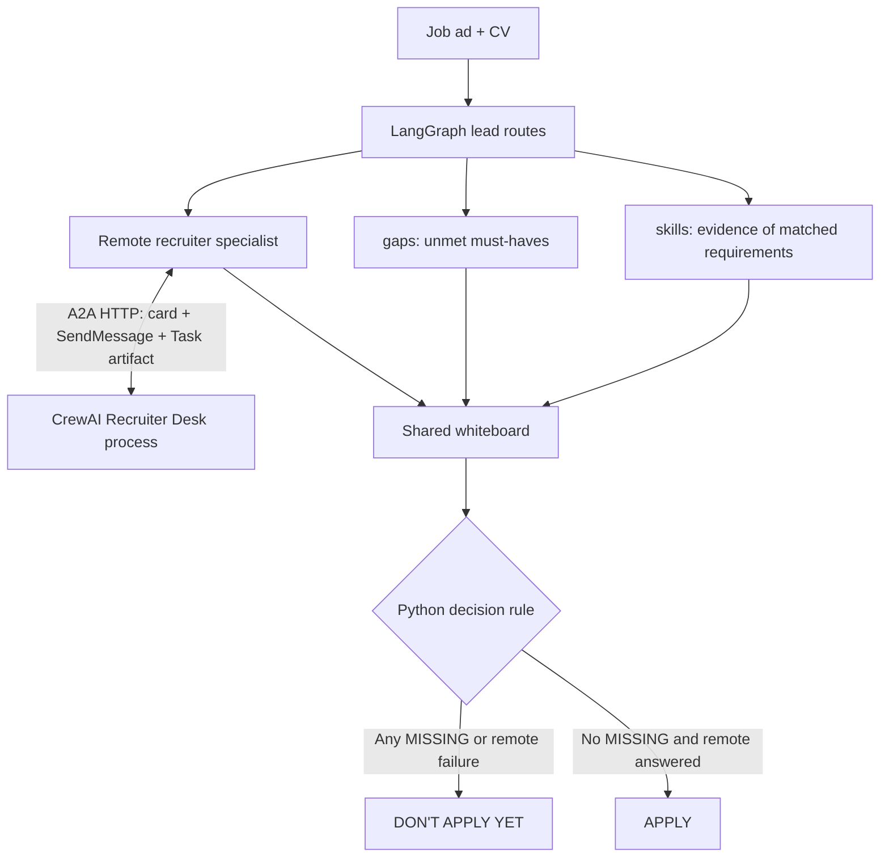

# Phase 4 Mini-Project — Job Application Desk

A LangGraph manager routes a job advertisement and CV to one local specialist (`skills` or `gaps`) and a remote CrewAI recruiter (`recruiter`) running in a separate process. The remote agent is discovered through its A2A agent card and called with JSON-RPC `SendMessage`; its answer returns as a Task artifact.

## Files

- `manager.py` — LangGraph lead, local specialists, A2A client, whiteboard, and deterministic decision.
- `remote_desk.py` — CrewAI recruiter served through A2A.
- `evidence/` — save real run transcripts and agent-card/desk logs here.

The scripts expect the course's `shared/setup_env.py` and `shared/meter.py` to remain in `Module-07-Multi-Agent-Systems/shared/`. Do not copy `.env` into this folder or the submission ZIP.

## Run in PowerShell

Open a terminal in `Module-07-Multi-Agent-Systems` and activate the same Python environment used for Exercise 3.

Terminal 1 — start the remote CrewAI desk:

```powershell
python .\my-network\remote_desk.py
```

Terminal 2 — run both inputs:

```powershell
python .\my-network\manager.py match
python .\my-network\manager.py stretch
```

The agent card is available at <http://127.0.0.1:9999/.well-known/agent-card.json>. To use another port, start the desk with `--port 9998` and run the manager with `--desk http://127.0.0.1:9998`.

## Decision rule

Python computes the final decision. A genuine whiteboard finding beginning with `[specialist] MISSING:` produces `DON'T APPLY YET`. If the remote recruiter cannot be contacted or does not return a valid completed A2A task, the manager also fails closed and returns `DON'T APPLY YET`. Otherwise, the decision is `APPLY`. Preferred qualifications are not must-haves, and either alternative in an “A OR B” requirement satisfies that requirement.

## Expected evaluation inputs

- `match`: junior data analyst; the sample CV demonstrates each must-have. Expected decision: `APPLY`; expected route: `skills` + `recruiter`.
- `stretch`: senior ML engineer; the recent graduate CV lacks multiple must-haves. Expected decision: `DON'T APPLY YET`; expected route: `gaps` + `recruiter`.

The model's routing output is validated against the allowed specialist names and a two-specialist budget. Because routing is model-assisted, inspect the printed route on both runs and adjust the lead prompt if the routes do not differ as expected.

## Safe-failure demonstration

1. Stop the desk with Ctrl+C in Terminal 1.
2. Run `python .\my-network\manager.py match` in Terminal 2.
3. Confirm the manager reports that the recruiter is unavailable and the final decision is `DON'T APPLY YET`.
4. Save the actual terminal output as `evidence/fail_closed.txt`.

## Evidence checklist

Save actual outputs, not invented examples. The `evidence/` folder currently contains clearly marked placeholders, not proof of successful runs. Replace them with real outputs using the commands in `evidence/README.md`.

- `evidence/run1.txt` — successful `match` run.
- `evidence/run2.txt` — successful `stretch` run.
- `evidence/fail_closed.txt` — run with the remote desk stopped.
- `evidence/card.json` — contents of the agent-card URL.
- `evidence/desk_log.txt` — output from Terminal 1 while it handles both calls.
- Include the cost cards printed by the manager and the remote desk in the relevant transcripts.

## Architecture diagram



## Would one agent have been enough?

Complete this paragraph after running the project and recording the real numbers: “One agent [would / would not] have been enough. The manager used ___ calls and ___ tokens and took ___ seconds; the remote recruiter used ___ calls and ___ tokens and cost $___ according to its own terminal. The specialist split helped by ___. A single agent might have ___.” Do not fill in these blanks until you have real measurements.

## Submission

Zip `my-network/` without `.env` or API keys. Include the source files, README, and real evidence files. Verify both successful routes and the remote-offline case before submitting.
